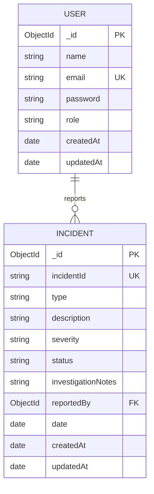

# SecureTrack

This application facilitates the creation, reporting and management of cybersecurity incidents. The user can report and manage incidents he/she reports; the administrator can view all incidents, update the investigation status, notes and delete the incidents.

## Features

- User registration, login, JWT-protected API routes, and role-based authorization
- CRUD operations on incident with support from MongoDB
- Access to an incident by its owner only and the administrator across all incidents
- Another page for the administrator where he/she can see the registered accounts.
- Dashboard metrics about the incident’s status, severity and type with the incidents the user can see
- Another page for the incidents with filter and search capabilities
- Dashboard summaries and responsive views
- Server-side validation, unique incident identifiers and proper error responses.

## Technology

- Frontend: HTML, CSS, browser JavaScript
- Backend: Node.js and Express.js
- Database: MongoDB with Mongoose
- Authentication: JWT and bcryptjs

## Setup

1. Install a supported Node.js version and run MongoDB locally or use a MongoDB connection string.
2. From `Backend`, install dependencies:

   ```powershell
   cd Backend
   npm install
   ```

3. Copy `Backend/.env.example` to `Backend/.env`. Configure:
   - `PORT`: API port (defaults to `5000`)
   - `MONGODB_URI`: MongoDB connection string
   - `JWT_SECRET`: a long, random signing secret
   - `ADMIN_BOOTSTRAP_KEY`: a secret used only to create the initial administrator
4. Start the API from `Backend`:

   ```powershell
   npm start
   ```

5. Serve the `Frontend` folder using a static web server and open `login.html`. The browser frontend expects the API at `http://localhost:5000`.

The `.env` file is ignored by Git. Do not commit real credentials. `.env.example` contains placeholders only.

## User roles

- **User:** register/login, create incidents, and view, edit, or delete their own incidents. Editable fields are type, description, and severity.
- **Administrator:** view, edit, and delete all incidents, including changing status and investigation notes; view registered accounts on `Frontend/users.html`; and view incident analytics on the dashboard.

The backend checks ownership and roles on every protected incident route; hiding a frontend button is not an authorization boundary.

To create the initial administrator, send the configured bootstrap key to `POST /create-admin` in the JSON `bootstrapKey` field or the `X-Bootstrap-Key` header. Public registration always creates an ordinary user. The bootstrap endpoint rejects creation after an administrator already exists.

## Main API

All routes use JSON. Protected routes require `Authorization: Bearer <token>`.

| Method | Endpoint | Access | Purpose |
|---|---|---|---|
| `POST` | `/register` | Public | Register an ordinary user |
| `POST` | `/login` | Public | Authenticate and receive a token |
| `POST` | `/logout` | Authenticated | End the client session |
| `GET` | `/me` | Authenticated | Read current user profile |
| `GET` | `/users` | Administrator | List registered users without password data on the separate Users page |
| `POST` | `/incidents` | Authenticated | Create incident for current user |
| `GET` | `/incidents` | Authenticated | List accessible incidents; supports `search`, `status`, `severity`, and `type` |
| `GET` | `/incidents/:id` | Owner or administrator | Read incident details |
| `PATCH` | `/incidents/:id` | Owner or administrator | Edit allowed incident fields |
| `PATCH` | `/incidents/:id/status` | Administrator | Change incident status separately |
| `PUT` | `/incidents/:id` | Administrator | Update status and investigation notes (legacy workflow endpoint) |
| `PUT` | `/incidents/:id/notes` | Administrator | Update investigation notes |
| `DELETE` | `/incidents/:id` | Owner or administrator | Delete own incident, or any incident as an administrator |
| `GET` | `/admin/stats` | Administrator | Read aggregate incident statistics |
| `POST` | `/create-admin` | Bootstrap key | Create the initial administrator |

Incident references combine a timestamp and random value and are protected by a unique MongoDB index. The database record's MongoDB `_id` remains the stable resource identifier.

## CRUD workflow

1. Log in and file an incident report. Backend validation of allowed incident type, severity, and description takes place and the record gets associated with the logged in user.
2. Incidents-based analytics are displayed on the dashboard. Access `Frontend/incidents.html` to search and filter incidents. Users get their own incidents, and administrators get incidents they manage.
3. Open an incident and click **Edit Incident**. Users can change type, description, and severity of the incident. Additionally, administrators have the ability to change incident status and investigation details.
4. Changes affect the existing document in MongoDB database. Protected identifiers, reporter, and date fields are not allowed for editing.
5. Owners of incidents and administrators can use **Delete** option to remove a record from the database. Normal users cannot delete incident of another user.

## Data relationship

There can be many incidents reported by one user. `Incident.reportedBy` field references `User`. Legacy incidents without a reporter can be read by administrators.



## Testing

From `Backend`, run:

```powershell
npm test
```

The integration test suite requires MongoDB at `127.0.0.1:27017`. It starts a separate API process and uses a uniquely named `securetrack_qa_*` database, which it drops during cleanup. It does not use the configured development database. The tests cover registration and login validation, role and ownership enforcement, incident CRUD, concurrent reference generation, filters, invalid IDs, and admin statistics